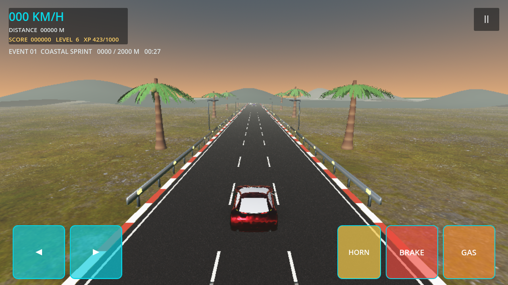
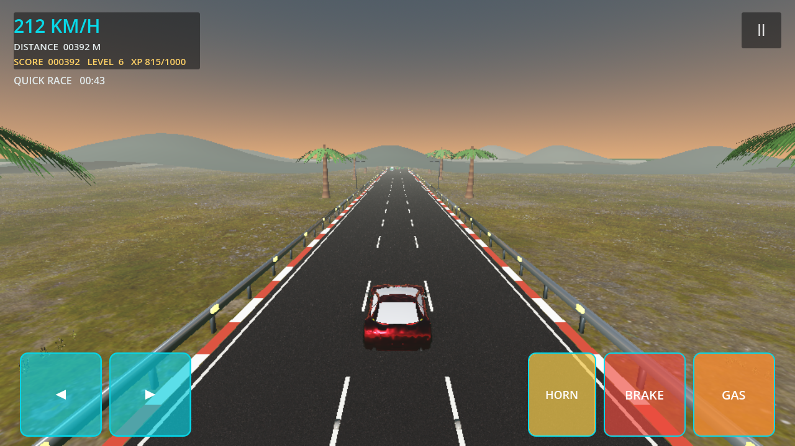
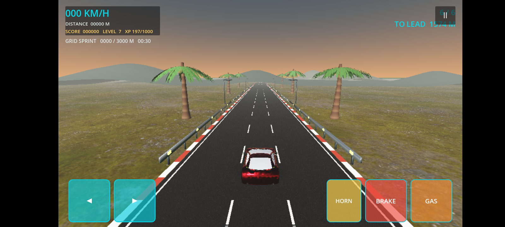
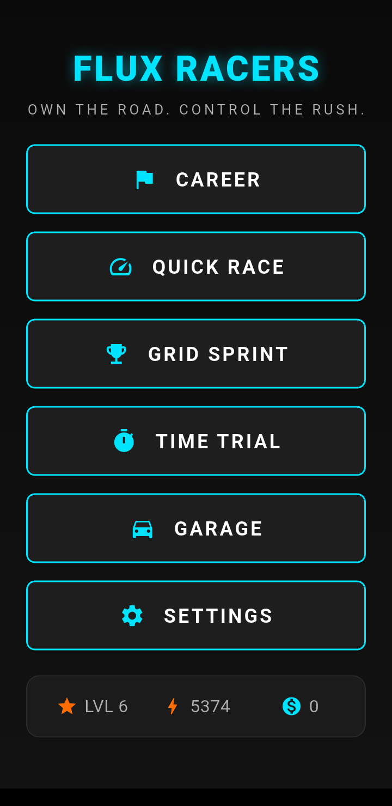
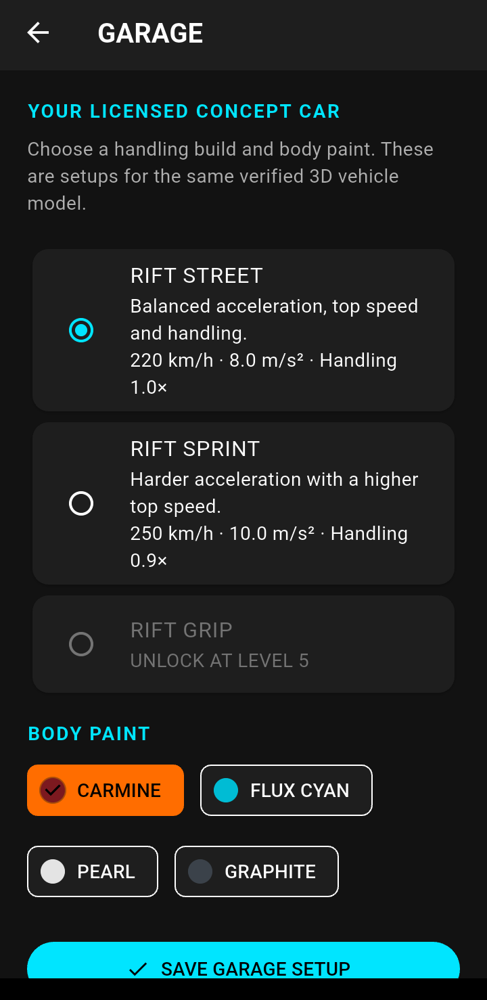
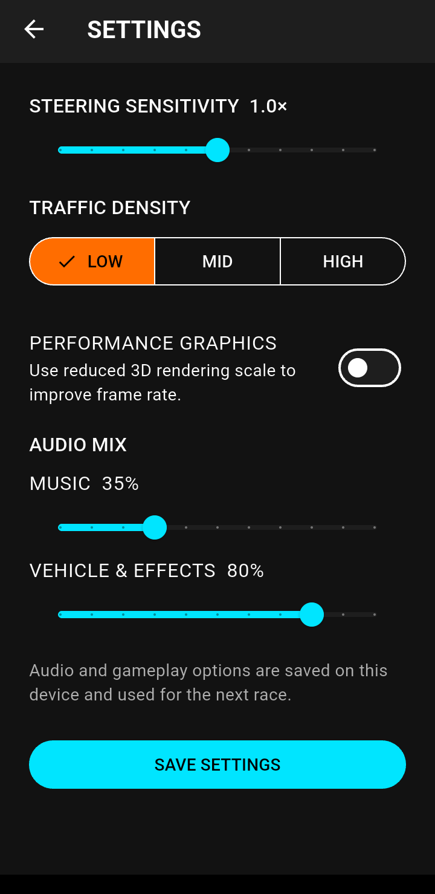

# Flux Racers

**Own the road. Control the rush.**

Flux Racers is an Android 3D racing game built with Flutter and Godot 4. Choose
a race mode, tune your car in the garage, and take on traffic, a six-driver
sprint, or a timed solo challenge on a stylized 3D highway.

> **Development status:** playable, actively developed, and not yet a
> production-complete release. The game currently targets Android; Web and iOS
> gameplay exports are not configured.

## Screenshots

Captured from the Android game. Menus run in portrait; races switch to
landscape.

<p align="center">
  
</p>

<table>
  <tr>
    <td align="center"><strong>Career</strong></td>
    <td align="center"><strong>Quick Race</strong></td>
    <td align="center"><strong>Grid Sprint</strong></td>
  </tr>
  <tr>
    <td></td>
    <td></td>
    <td></td>
  </tr>
</table>

<table>
  <tr>
    <td align="center"><strong>Main menu</strong></td>
    <td align="center"><strong>Garage</strong></td>
    <td align="center"><strong>Settings</strong></td>
  </tr>
  <tr>
    <td></td>
    <td></td>
    <td></td>
  </tr>
</table>

## Race modes and features

- **Quick Race** — open-ended solo driving with configurable traffic.
- **Career** — an offline three-event series with 2 km, 4 km, and 6 km races,
  unlocks, rewards, and personal-best records.
- **Grid Sprint** — a 3 km, six-driver point-to-point race with AI rivals,
  position telemetry, collision handling, and finish results.
- **Ghost Time Trial** — complete 3 km within 75 seconds. Beat the deadline to
  save a local personal-best run and race its translucent, non-colliding ghost;
  time out and the race ends.
- **Garage** — select a handling build and paint scheme for the concept car.
- **Race settings** — adjust steering sensitivity, traffic density, graphics
  quality, and audio levels.
- **3D presentation** — a textured road and terrain, roadside scenery,
  instanced trackside details, chase camera, and race audio.
- **Progression** — local profile points, experience, levels, credits, event
  unlocks, and race records.

## Technology and architecture

- **Flutter** provides the Android app shell, navigation, menu, garage, and
  settings screens.
- **Godot 4** runs the 3D race in a native Android landscape activity.
- The Godot race runs in its own Android process; the Flutter host communicates
  race mode and player options to it.
- Godot gameplay data and player options are stored locally on the device.
- The Android build packages Godot project assets with the app. Pre-optimized
  vehicle and traffic resources reduce runtime model processing.

## Run on Android

### Requirements

- Flutter SDK and Dart SDK matching the versions in `pubspec.yaml`.
- Android SDK/NDK configured for Flutter.
- Godot 4.7 (or a compatible Godot 4 release) available on `PATH`, or the
  `GODOT_EXECUTABLE` environment variable set to the Godot executable.
- An Android device or emulator. Find connected device IDs with
  `flutter devices`.

From the repository root in PowerShell:

```powershell
flutter pub get
$env:GODOT_EXECUTABLE = 'C:\path\to\Godot_v4.7.2-stable_win64.exe'
$deviceId = 'YOUR_ANDROID_DEVICE_ID'
flutter run -d $deviceId
```

If Godot is already on `PATH`, omit the `$env:GODOT_EXECUTABLE` line.

### Build Android APKs

Build debug APKs split by processor architecture:

```powershell
flutter build apk --debug --split-per-abi
```

The APKs are written to `build\app\outputs\flutter-apk\`. Install the APK
matching the device ABI to avoid the extra size of a universal APK. Check the
device's supported ABIs with:

```powershell
adb shell getprop ro.product.cpu.abilist
```

For example, to run the 32-bit ARM build:

```powershell
$deviceId = 'YOUR_ANDROID_DEVICE_ID'
flutter run -d $deviceId `
  --use-application-binary=build\app\outputs\flutter-apk\app-armeabi-v7a-debug.apk
```

Use `app-arm64-v8a-debug.apk` or `app-x86_64-debug.apk` for the corresponding
device architecture.

## Validate changes

Run Flutter analysis and tests:

```powershell
flutter analyze
flutter test
```

Run every Godot regression test:

```powershell
Get-ChildItem godot\tests -Filter '*_test.gd' | ForEach-Object {
  godot --headless --path godot --script "res://tests/$($_.Name)"
  if ($LASTEXITCODE -ne 0) {
    throw "Godot test failed: $($_.Name)"
  }
}
```

## Assets and licensing

The vehicle is an attributed Khronos CC-BY-4.0 concept model, not a real-world
marque. Road, terrain, and shrub assets include verified CC0 Poly Haven
materials; traffic includes Kenney CC0 Car Kit models. Some scenery and audio
are project-authored. Review
[the asset credits and license details](godot/assets/ASSET_LICENSES.md) before
redistributing the game or its assets.

## Project scope

Flux Racers is an evolving mobile racing project with a stylized 3D presentation.
It is not a photorealistic simulator, and performance varies by device. Android
is the currently integrated gameplay target; Godot Web export and Flutter Web
hosting are not implemented.

## Publish the showcase website

The responsive game showcase is in `site/`. It is a static information website
with optimized screenshots; it does **not** run the 3D game in a browser.
Netlify uses the included `netlify.toml`, and Vercel uses `vercel.json`.

Preview it locally from the repository root:

```powershell
python -m http.server 8000 --directory site
```

Then open `http://localhost:8000`.

To get a public URL, first push this repository to GitHub. Create an empty
GitHub repository, then connect it from PowerShell (replace the example URL):

```powershell
git remote add origin https://github.com/YOUR-USERNAME/flux-racers.git
git push -u origin main
```

On **Netlify**, sign in, choose **Add new site → Import an existing project**,
select the GitHub repository, and deploy. The checked-in configuration
publishes `site/` without a build step.

On **Vercel**, choose **Add New → Project**, import the GitHub repository, and
deploy. The checked-in configuration publishes the same static `site/`
directory. Either host will provide a public HTTPS URL after deployment; a
custom domain can be connected later in that host's project settings.
